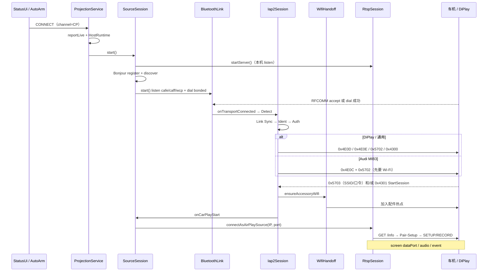

# 无线 CarPlay 连接逻辑

> 角色：本模块 = **Source（假 iPhone）**；车机 / DiPlay = **Receiver（配件）**。  
> 范围：从「选 CarPlay 通道」到「AirPlay 控制 TCP 建链 + screen/audio SETUP」的**建连时序**。  
> 出画 / 编码 / 触控 / NowPlaying 见 [EXECUTION.md §14](EXECUTION.md)；协议字节对照见 [CARPLAY_REFS.md](CARPLAY_REFS.md)；奥迪个案见 [AUDI_CARPLAY_CONNECT_ANALYSIS.md](AUDI_CARPLAY_CONNECT_ANALYSIS.md)。

---

## 1. 一句话总览

```
状态页选 CarPlay
  → FGS + Host GL 武装
  → BT RFCOMM（listen …cafe / dial …caff）
  → iAP2（Detect → Link Sync → Ident → Auth → Wi‑Fi / StartSession）
  → 加入车机热点
  → AirPlay/RTSP 控制 TCP（GET /info → Pair-Setup → SETUP/RECORD）
  → screen / audio / event 通道
```

没有 MFi 协处理器：Source 侧 Auth 发 `0xAA05` 成功、**不验签**。真车若强校验证书，会卡在 Auth 之后。

---

## 2. 启停入口

| 触发 | 行为 | 代码 |
|------|------|------|
| 状态页「出口通道 = CarPlay」 | `CarPlayChannel` 持久化 → `CarPlayProjectionService.CONNECT` | `CarPlayStatusUi`、`CarPlayChannel` |
| 开机 / 换包 / BT ON / 解锁 | 若通道已是 CarPlay → 重武装 FGS（尽早 listen `…cafe`） | `CarPlayAutoArmReceiver` |
| STOP / 切回 AA | `tearDown` → 停 Session / Host；通道改 AA | `CarPlayProjectionService` |

通道文件：`filesDir/aadisplay_carplay_channel`（`0`=AA，`1`=CarPlay）。默认 **AA**，真车行为不变。

FGS `ensureSession()` 顺序（硬约束）：

1. `reportCarPlaySessionLive(true)`（先于 Host / SETUP，避免 Coolwalk 把 VD 压小）
2. `CarPlayHostRuntime.ensureStartedSync`（GL 先于编码器）
3. `CarPlaySourceSession.start()`
4. 可选 `CarPlayHostActivity` trampoline（销毁不拆画面）

会话存活：app 内 `ProjectionSessionGate`；system_server 经 `CoreApi.reportCarPlaySessionLive` → Delay Destroy 挂起 + `CarPlayProcessBoost`。

---

## 3. 连接时序（端到端）



并行注意：

- **RTSP listen + Bonjour** 在 BT 握手前就起来；主路径仍是 `0x4301` 后 Source dial。
- Bonjour 解析到对端 `_carplay-ctrl._tcp.` 也会 `rtsp.connect`（辅路径；忽略本机 `AADisplay-CarPlay`）。
- RFCOMM 断开 → 停媒体流 + NowPlaying，便于对端重 Auth。

---

## 4. 分层说明

### 4.1 蓝牙 RFCOMM（`CarPlayBluetoothLink`）

协议 UUID（Apple 常量，集中在 `CarPlayConsts`，不是某车机魔法值）：

| UUID | 角色 | 谁 dial |
|------|------|---------|
| `…deafdecacafe` | Phone（本机 listen） | 车机 / DiPlay 回连 |
| `…deafdecacaff` | Accessory（本机也可 listen；并对 bonded dial） | 本模块首连 HU |
| Wireless CarPlay capability | SDP/EIR 能力广告 | —（VAG 等缺此 UUID 不出 CarPlay） |

身份与车机策略（`carplay/profile/`）：

- **`CarPlaySourceIdentity`**：BT 广告名、iAP/AirPlay 手机字段（默认 `iphone14_2`）。
- **`CarPlayHuProfile`**：dial 策略、AirPlay UA/HKP/版本、MIB3 vs Generic 无线路径。
- **`CarPlayProfileResolver`**：按 iAP ident → SSID → BT 名（registry 内 hint）解析 HU；未命中 → `generic`。
- 新手机 / 新车机：改注册表，禁止在 BT/iAP/RTSP 再写 `contains("audi")` / `"iPhone14,2"`。

武装时：

- 适配器改名为 `SourceIdentity.btAdvertiseName`（停会话时恢复）；尽量 `SCAN_MODE_CONNECTABLE_DISCOVERABLE`。
- BT OFF 时挂 `STATE_CHANGED`，ON 后再 `beginRfcomm`（避免 reboot 永久放弃 → DiPlay SDP `scn=0`）。
- bonded 扫描 dial `…caff`（按 accessory / wireless-CP UUID 排序）；`INBOUND_PREFERRED` 车机在 ACL/新配对后再 dial。**已有 socket 且 iAP 协商中禁止红 dial**。
- 保留 HFP；**不主动开 A2DP**（部分 HU 会超时提示「无法建立蓝牙」）。

### 4.2 iAP2 状态机（`protocol/Iap2Session`）

| 阶段 | 要点 |
|------|------|
| Detect | 本机先发 `FF 55 02 00 EE 10`；探测重传 |
| Link Sync | `FF 5A` SYN/ACK，协商 MTU / session（control + file transfer） |
| Identification | `0x1D00` → 收 `0x1D01` → `0x1D02` |
| Auth | `0xAA00…05`；本模块不验签。MIB3：证书请求与 20B challenge 同批 |
| Wireless | 见下；MIB3 与 DiPlay **顺序不同** |

**DiPlay / 通用**（Auth 后立刻）：

```
0x4E0D WirelessCarPlayUpdate AVAILABLE
0x4E0E DeviceTransportIdentifier（BT MAC）
0x5702 RequestAccessoryWiFiConfiguration
0x4300 CarPlayAvailability（wireless）
→ 等 0x5703 和/或 0x4301
```

**MIB3**（`HuProfile.id=mib3`；registry hint 含 audi/mmi，仅经 Resolver）：

```
0x4E0C wireless session id + 0x5702   ← 先要热点
→ 收 0x5703 → 加入 Wi‑Fi
→ 0x4E0D / 0x4E09(name=iPhone) / 0x4E0E / 0x4300
→ 等 0x4301；2.5s 未见到则重发 0x4300；Wi‑Fi bound 后再发一次
```

`0x5703` → `CarPlayWifiHandoff.ensureAccessoryWifi`；`0x4301` → `dialCarPlayControl`（有 SSID 则等 Wi‑Fi ready）。

### 4.3 Wi‑Fi handoff（`CarPlayWifiHandoff`）

- `WifiNetworkSpecifier` 加入配件 AP；**勿 unregister 活着的 Specifier**（One UI 会立刻掉 L2）。
- 用本地回调 **hold** 住无 INTERNET 的 AP，避免三星 `CMD_UNWANTED_NETWORK` 2–3s 踢线。
- 入网前 `CoreApi.preferCellularOverUnvalidatedWifi`，避免未验证 STA 抢默认路由掐蜂窝。
- dial 前走 `CarPlayAccessoryNet` 绑到配件 Network，禁止走 LTE 默认路由撞 `10.x`。

### 4.4 控制 TCP / AirPlay（`CarPlayRtspSession`）

`dialCarPlayControl`：

1. 优先 `0x4301` 里非 link-local IPv4；否则 DHCP/网关 hint。
2. 最多约 12 次 TCP probe + `connectAsAirPlaySource`（失败且未绑 Wi‑Fi 则再 kick handoff）。
3. Source dial：`GET /info` → Pair-Setup（MIB3 用偏旧 UA/HKP）→ Pair-Verify → 加密 SETUP/RECORD。
4. 本机也可 accept 入站 RTSP（Bonjour / 对端主动连）。

出画在 SETUP screen 之后；连接文档到此为止。后续见 EXECUTION §14.1。

---

## 5. 类职责速查

| 类 | 连接职责 |
|----|----------|
| `CarPlayChannel` | AA ↔ CarPlay 互斥通道持久化 |
| `CarPlayAutoArmReceiver` | 开机/BT/解锁重武装 FGS |
| `CarPlayProjectionService` | FGS 拥有 Session；live 上报 |
| `CarPlaySourceSession` | 编排 Bonjour + BT + iAP2 + Wi‑Fi + RTSP |
| `CarPlayBluetoothLink` | RFCOMM listen/dial、名称/可发现、配对监听 |
| `Iap2Session` / `Iap2Framing` / `Iap2Csm` | iAP2 成帧与状态机 |
| `CarPlayWifiHandoff` | 配件热点加入与 hold |
| `CarPlayBonjour` | `_carplay-ctrl._tcp.` 注册/发现 |
| `CarPlayRtspSession` | RTSP listen + AirPlay Source dial |
| `CarPlayAccessoryNet` | 配件 Network 上开 TCP |
| `ProjectionSessionGate` | app 侧 CP live 位 |

---

## 6. 常见断点（排查顺序）

| 现象 | 优先查 |
|------|--------|
| 车机只有普通蓝牙电话，无 CarPlay | RFCOMM 是否真正连上（`…cafe` accept / `…caff` dial）；通道是否 CarPlay；AutoArm 是否起了 FGS |
| DiPlay 有声无屏 / SDP `scn=0` | 本机是否在 listen `…cafe`（BT 未 ON 就放弃过） |
| Auth 后无热点 / 无 StartSession | 是否 MIB3 路径；是否已发 `0x5702`；是否收到 `0x5703`/`0x4301` |
| 有 StartSession 但 dial 失败 | Wi‑Fi 是否 bind；是否走了蜂窝；IPv4 是否只有 `fe80` |
| 连上又秒断 AP | Specifier hold 是否被 unregister；三星 UNWANTED |
| GL/编码很热闹但车机无会话 | 旧 DiPlay RFCOMM 占着 socket，对新车 dial 被丢弃 |

日志标签：`CarPlayConsts.TAG`（`AADisplay_CarPlay` 一类）。关键字样：`RFCOMM`、`iAP`、`WiFi handoff`、`CarPlayStartSession`、`AirPlay source dial`。

---

## 7. 与其它文档的分工

| 文档 | 内容 |
|------|------|
| **本文** | 建连时序与断点 |
| [EXECUTION.md §14](EXECUTION.md) | 运行时出画 / 音频 / 触控 / 包边界 |
| [CARPLAY_REFS.md](CARPLAY_REFS.md) | 外部协议参考与字节序 |
| [CARPLAY_MAC_TEST.md](CARPLAY_MAC_TEST.md) | Mac Simulator 联调 |
| [AUDI_CARPLAY_CONNECT_ANALYSIS.md](AUDI_CARPLAY_CONNECT_ANALYSIS.md) | 奥迪 MMI 连不上的监测与计划 |
| [USB_CARPLAY.md](USB_CARPLAY.md) | **有线** USB fake-iPhone（另一条物理路径） |
