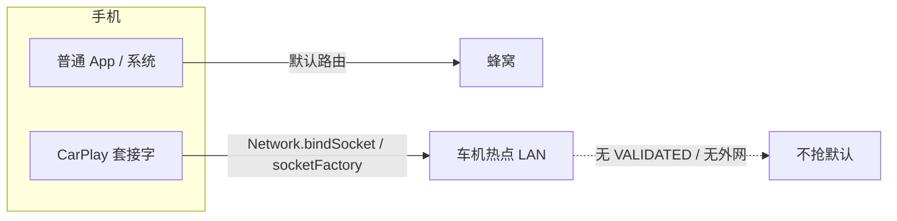

# CarPlay：连车机 Wi‑Fi 无网、手机继续走流量

> 范围：无线 CarPlay 入网后，如何让 **L2/LAN 挂在配件热点**，同时 **整机互联网仍走蜂窝**。  
> 建连总序见 [CARPLAY_CONNECT.md](CARPLAY_CONNECT.md)；出画见 [EXECUTION.md §14](EXECUTION.md)。

---

## 1. 要解决的问题

车机 / DiPlay 热点（SSID 如 `Carplay`、Audi MMI 等）通常：

- 有 DHCP、有 `10.x` 局域网，**没有**可验证的外网；
- Android 会把它当成「坏 Wi‑Fi」：要么几秒内 `CMD_UNWANTED_NETWORK score=0` 踢线，要么用户点过「仍要连接」后打上 `ACCEPT_UNVALIDATED`，把 **wlan0 设成默认路由** —— 但默认路由上没有真正的 gateway → 整机「有 Wi‑Fi 却没网」，LTE 还在却用不了。

目标状态：

| 流量类型 | 走哪条路 |
|----------|----------|
| CarPlay 控制 / 视频 / 音频 / event（TCP/UDP 到配件） | 配件 Wi‑Fi `Network` |
| 地图、微信、系统更新等 INTERNET | 蜂窝（LTE/5G） |
| DNS / 进程默认路由 | **不要**绑到无网热点 |

---

## 2. 一句话策略

**系统默认路由留给蜂窝；CarPlay 只在 socket 级绑定配件 Network。**

禁止用 `ConnectivityManager.bindProcessToNetwork(配件)` 当「永久绑网」——那会把本进程（含 DNS）钉死在无网 AP，并干扰 OEM「停留 Wi‑Fi」路径。



---

## 3. 调用时序（何时动手）

```
iAP 0x5703 AccessoryWiFi
  → CoreApi.preferCellularOverUnvalidatedWifi()   // 入网前先清 ACCEPT / autojoin
  → CarPlayWifiHandoff.ensureAccessoryWifi(...)
       → WifiNetworkSpecifier（local-only，无 INTERNET capability）
       → onAvailable / adopt
            → CarPlayAccessoryNet.set(network)     // 只记 Network，不 bindProcess
            → bindProcessToNetwork(null)           // 清掉残留进程绑网
            → holdCellularForInternet()            // request 蜂窝 INTERNET，保 NetworkAgent
            → preferCellular…（立即 + 1.5s + 4s）  // 三星可能重建 Agent 再盖章
  → 0x4301 StartSession → dial：所有 TCP/UDP 经 CarPlayAccessoryNet
```

入口代码：

- 入网前：`CarPlaySourceSession` 的 `onWifiConfig`
- 绑定后重试：`CarPlayWifiHandoff.bindNetwork` → `preferCellularNow`

---

## 4. App 侧（`CarPlayWifiHandoff` + `CarPlayAccessoryNet`）

### 4.1 Local-only Specifier（挂住无网 AP）

`NetworkRequest`：

- `TRANSPORT_WIFI` + `WifiNetworkSpecifier(SSID[/WPA2])`
- **`removeCapability(NET_CAPABILITY_INTERNET)`**

作用：

1. 不要求 VALIDATED，避免无网 AP 被打成 score=0 秒踢；
2. 全程 **hold** 住 Specifier 回调——**不要** `unregisterNetworkCallback`（One UI 上会立刻掉 L2）；
3. 仅 adopt 已存 STA、没有 hold 时，三星仍可能 2–3s `UNWANTED` 拆网。

### 4.2 进程不绑配件；socket 才绑

`bindNetwork`：

```text
CarPlayAccessoryNet.set(network)
cm.bindProcessToNetwork(null)   // 显式清进程级绑网
holdCellularForInternet()
preferCellular…（含延迟重试）
```

`CarPlayAccessoryNet`：

- `openTcp()` / `openUdp()` / `bind(Socket|DatagramSocket)` 全部走配件 `Network`；
- **缺 Network 时禁止回退到裸 `Socket()`**——默认路由已是 LTE 时，源地址会变成蜂窝侧 `10.x`，永远到不了车机 AP。

### 4.3 蜂窝 hold

`requestNetwork(TRANSPORT_CELLULAR + NET_CAPABILITY_INTERNET)`：

- 会话期间保持蜂窝 NetworkAgent 活着，方便 ConnectivityService 把 INTERNET 默认选到 LTE；
- 释放会话时 `releaseCellularHold()`。

这不是「强制所有 App 走流量」的 API，而是配合下面 system_server 步骤，避免默认被无网 Wi‑Fi 抢走。

---

## 5. system_server 侧（`CoreApi.preferCellularOverUnvalidatedWifi`）

经 PMS 桥进 `CoreManagerService`（需已注入 system_server）。在 **cleared calling identity** 下做三件事：

| 步骤 | 做什么 | 为什么 |
|------|--------|--------|
| 1 | `Settings.Global.network_avoid_bad_wifi = 1` | 系统倾向避开未验证 Wi‑Fi 作默认 |
| 2 | 对车机类 SSID 的 `WifiConfiguration`：`noInternetAccessExpected = true` + `updateNetwork` | 告诉框架「这网本来就不该当外网」 |
| 3 | 同配置 `allowAutojoin(netId, false)` | 阻止 WifiNetworkFactory **自动重连已存 STA** 再盖 `ACCEPT_UNVALIDATED`；Specifier 入网仍可用 |

**不做** `setAcceptUnvalidated(false)` / `reportNetworkConnectivity(false)`。这两步会拆掉 WIFI NetworkAgent：wlan0 仍关联、Specifier 回调仍 pending，但 `getAllNetworks()` 里没有 Wi‑Fi，AirPlay 无法 `bindSocket`。默认路由靠步骤 1，不靠拆 Agent。

车机 SSID 启发式（`isCarHotspotSsid`）：含 `audi` / `mmi` / `carplay` / `diplay`，或以 `carplay` 开头。

**刻意不做的事：**

- 不调 `setAvoidUnvalidated` / `setAcceptUnvalidated(false)`——会拆 WIFI NetworkAgent（L2 可能还在，但没有可 bind 的 Network）；
- 不依赖用户每次点「使用移动数据」。

---

## 6. 职责对照

| 组件 | 职责 |
|------|------|
| `CarPlayWifiHandoff` | Specifier 入网 / hold / rejoin；触发 cellular hold + preferCellular |
| `CarPlayAccessoryNet` | 配件 Network 上的 TCP/UDP 工厂（会话级单例） |
| `CoreManagerService.preferCellularOverUnvalidatedWifi` | 系统默认路由与 saved STA 策略（需 Xposed system_server） |
| `CarPlaySourceSession` / `CarPlayRtspSession` / audio·event egress | 只经 `CarPlayAccessoryNet` dial/送流 |

AIDL：`ICoreManager.preferCellularOverUnvalidatedWifi()`；客户端 `CoreApi` → `CoreManager` → 桥。

---

## 7. 真机现象与排查

| 现象 | 优先查 |
|------|--------|
| 连上 CarPlay 后手机「没网」 | `network_avoid_bad_wifi` 是否为 1；用户是否又点了「仍要连接」 |
| 有网但 dial `ECONNABORTED` / 超时 | 是否误走 LTE；`CarPlayAccessoryNet.hasNetwork()`；日志勿出现 unbound dial |
| AP 2–3s 掉线、AirPlay reset | Specifier 是否被 unregister；是否只有 adopt 无 hold；`CMD_UNWANTED_NETWORK` |
| Specifier pending 很久、saved STA 有「假 INTERNET」 | `mMatchLocalOnlySpecifiers=false` 路径；应 adopt + listen 或 Specifier hold（见 handoff 注释） |
| `already pending` 且无 AirPlay | CS 里是否还有 WIFI NetworkAgent；没有则应看到 `specifier without Network — re-request` |
| 切模块后 preferCellular 无效 | system_server 未重启 / Stub 未注入；看 `CoreManagerService` 日志 |

日志关键字：

- App：`WiFi handoff`、`cellular hold available`、`preferCellularOverUnvalidatedWifi failed`
- system：`noInternetAccessExpected=true`、`allowAutojoin(false)`、`network_avoid_bad_wifi`

---

## 8. 设计边界（勿回退）

1. **双路径不可合并成进程级 bind**——回退会重新「连热点就没流量」。
2. **Hold Specifier 优先于「干净 unregister」**——踢线比回调泄漏更致命。
3. **preferCellular 要延迟重试**——Samsung 重建 NetworkAgent 会再盖 ACCEPT。
4. **autojoin off 只针对车机 SSID**——不要全局关 Wi‑Fi 自动加入。
5. 本逻辑依赖 Root + LSPosed system_server；纯 App 权限做不到 `allowAutojoin`。
