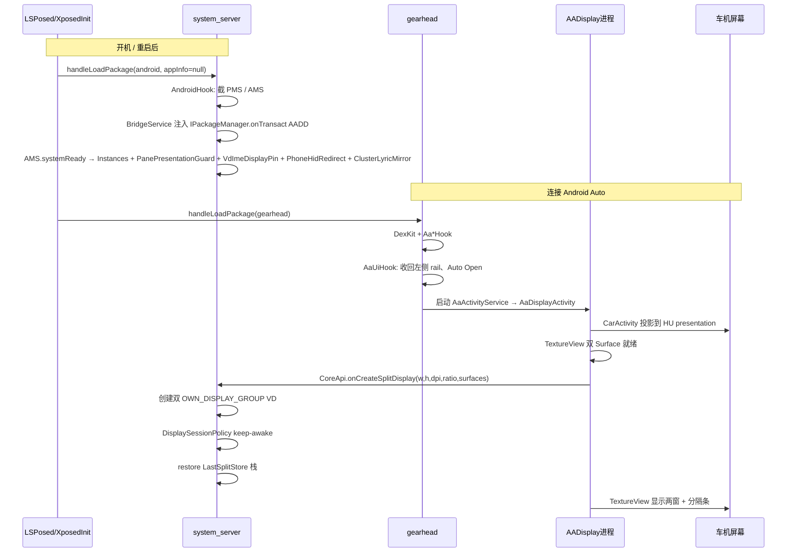
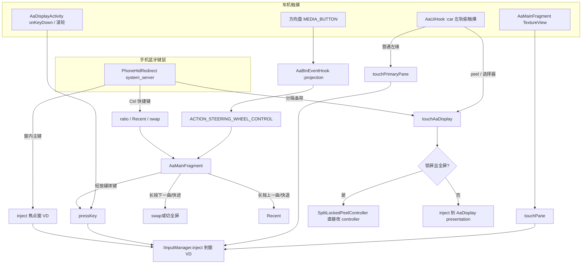
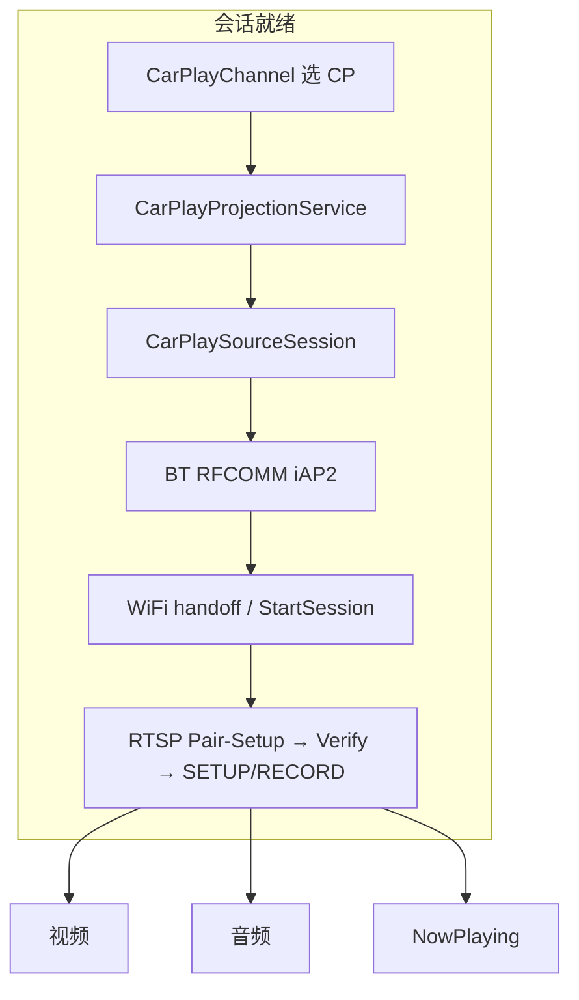

# EXECUTION.md — AADisplay 运行时逻辑链路

给后续 AI / 开发者用的**执行顺序文档**。仓库地图、改动硬规则、LSPosed scope 见根目录 [AGENTS.md](../AGENTS.md)。  
**改显示、IPC、钩子、触控、会话生命周期前先读本文**，再动代码。

路径均相对仓库根。Kotlin 源码默认在 `aa-display/src/main/java/io/github/nitsuya/aa/display/`。

---

## 0. 先建立的心智模型

本模块不是普通 App：它是 **LSPosed 模块**。真正干活的代码跑在 **system_server**；车机画面跑在 **AADisplay 进程的 CarActivity**；Android Auto（gearhead）只负责 HU 壳、把触控/按键偷过来、以及把本模块当成投影 App 拉起。

```
手机 HU 画面 = AaDisplayActivity 里两块 TextureView 合成
应用真实窗口 = system_server 里两块独立 VirtualDisplay（PRIMARY / SECONDARY）
跨进程能力   = 只能走 CoreApi → ICoreManager（禁止在 AA / App 进程直接 createVirtualDisplay）
```

三进程（再加被投应用自己的进程）：

| 进程 | 谁注入 | 常驻对象 | 禁止做的事 |
|------|--------|----------|------------|
| `system_server` | `AndroidHook` | `CoreManagerService`、`SplitDisplayController`、`DisplaySessionPolicy`、`ClusterLyricMirror` | 不要从这里 inflate 车机 UI |
| `io.github.nitsuya.aa.display` | 无 Xposed 钩子 | `AaDisplayActivity` / `AaMainFragment` | 不要直接操作 VD / ATMS |
| `io.github.nitsuya.aa.display:cluster` | 无 | `ClusterLyricMediaService`（隐形媒体壳 Title 出站） | 不要碰分屏 VD / 投影 UI |
| `gearhead`（`:projection` / `:car`） | `AndroidAutoHook` → `Aa*Hook` | Coolwalk 壳、HU 触控、Auto Open、仪表 Title 改写 / 媒体白名单 | 不要在这里创建分屏 VD |
| 被投 App | 无（仅 DPI pin 等 system 侧） | 任务窗口画在 VD 上 | — |

`CoreApi` 选路（`CoreApi.kt`）：**只有真正的 system_server**（`AndroidHook.isReadyForSystemHooks()`）才用 `CoreManagerService.instance`；其余一律 `CoreManager` 经 PMS 桥拿 Binder。不要用 `uid == 1000` 判断——三星等 OEM 系统应用也是 1000。

---

## 1. 总链路（从开机到车机有画面）



---

## 2. 模块加载（Xposed 入口）

入口文件：`aa-display/src/main/assets/xposed_init`  
类：`xposed/XposedInit.kt`

1. `initZygote` → EzXHelper。
2. `handleLoadPackage` **只认两路**，其余包不注入：

| 条件 | 对象 | 进程确认 |
|------|------|----------|
| `packageName == "android"` **且** `lpparam.appInfo == null` | `AndroidHook` | 再用 `/proc/self/cmdline == system_server`（`AndroidHook.isReadyForSystemHooks()`） |
| `packageName == com.google.android.projection.gearhead` | `AndroidAutoHook` | 再按 `processName` 过滤各 `AaHook` |

LSPosed scope（`res/values/arrays.xml`）：`android` + gearhead。少勾一项则对应半边整条链路断。

---

## 3. system_server 起桥（没有这一步，车机 UI 全是空转）

文件：`xposed/hook/AndroidHook.kt`、`xposed/BridgeService.kt`

```
ServiceManager.addService("package")
  → 拿到 IPackageManager
  → BridgeService.register(pms)
  → hook IPackageManager.onTransact
  → code == 'AADD' 且 uid ∈ {本模块, gearhead}
  → reply.writeStrongBinder(CoreManagerService.instance)

AMS 构造 → 捕获 system UI Context → CoreManagerService.systemContext
AMS.systemReady → Instances.init + PanePresentationGuard + VdImeDisplayPin + VdOrientationFill + PhoneHidRedirect + ClusterLyricMirror
```

客户端拿 Binder：`xposed/CoreManager.kt` `getService()`  
`ServiceManager.getService("package")` → transact `TRANSACTION=AADD` + `ACTION_GET_BINDER=1`。

硬约束：

- magic **`AADD`**、descriptor `android.content.pm.IPackageManager` 禁止改名。
- 只放行 **本模块 uid** 和 **gearhead uid**（`:car` 轨触控也要过桥）。
- AIDL **只能在接口末尾追加** 方法，否则旧 system_server Stub 序数错位（需重装模块并重启）。

---

## 4. Android Auto 侧钩子（gearhead 进程）

总控：`xposed/hook/AndroidAutoHook.kt`

`Instrumentation.callApplicationOnCreate` 里：先读 `DexKitMethodCache`（gearhead `cache/aadisplay_dexkit_{car|projection}.properties`）；全命中则跳过扫包，否则 `System.loadLibrary("dexkit")` → 未命中 hook 的 `loadDexClass` → `saveCache` → `hook()`。
每个 hook 的 `loadDexClass` / `hook` **单独** `runCatching`：某一个失败只跳过该 hook，其余仍会装上（日志 `AAD_AndroidAutoHook` / `AAD_*` / `AAD_DexKitCache`）。
DexKit 查询 **不要** 写 `searchPackages = listOf("")`（2.0.7 会只搜无名包，`AaSignatureHook` / LayoutInfo 等命中 0）。

进程常量（`AaHook`）：

- `:projection` = `com.google.android.projection.gearhead:projection`
- `:car` = `com.google.android.projection.gearhead:car`

| Hook | 进程 | 做什么 |
|------|------|--------|
| `AaSignatureHook` | `:car` | 本模块包名签名校验返回 true，AA 才肯跑 CarActivity |
| `AaFrxRequiredAppsHook` | 两者 | Google App / Maps / TTS 的 FRX 状态强制 READY |
| `AaNavFallbackHook` | 两者 | 禁用 `NavigationFallbackCarActivityService`（缺 Maps 否则占位页崩 `:car`） |
| `AaMediaPlaceholderHook` | 两者 | **保持** `MediaCarAppService` 启用（元数据出站）；隐藏残留 Dashboard / 壳相关媒体 Presentation；吞 Dashboard cover 断言 |
| `AaMediaAllowlistHook` | 两者 | 本包免「未知来源」/ 媒体资格；配合 `:cluster` `ClusterLyricMediaService` 出站仪表 Title |
| `AaClusterLyricEgressHook` | 两者 | 读 `MediaMetadata` Title/Subtitle 时注入 `ClusterLyricStore` 仪表横条文案 |
| `AaBtnEventHook` | `:projection` | 偷 MEDIA_BUTTON / projected.KEY_EVENT → 广播给车机 UI |
| `AaUiHook` | 两者（职责不同） | 见下节 |

### 4.1 AaUiHook 内部分工

文件：`xposed/hook/aa/AaUiHook.kt`（DexKit + 资源 id，易碎）

**`:projection`（AA 壳 / Facet / VD 尺寸）**

1. 把 Coolwalk 左侧 rail 相关 dimen **置 0**，让内容区拿满 HU 宽。
2. `LayoutInfo` 强制 `hasVerticalRail=true`，避免 800×480 掉回底栏。
3. `CoolwalkFacetChrome`：折叠 facet 列、全窗扫 gutter；`GhFacetBar` VD **饿成 1×H**（见 [COOLWALK_FACETBAR.md](COOLWALK_FACETBAR.md)）。
4. `rewriteVirtualDisplayArgs`：名为 `Dashboard` 的 VD **饿成 1×1**（空媒体卡）。
5. `content_bounds` 扩满 → 广播 `ACTION_COOLWALK_FULL_BLEED` → `AaMainFragment.requestDisplay`。
6. Auto Open：武装后立刻 + 分档重试调用 `CarSystemUiControllerService` 静态 `start(Intent)`；`car-connected` 再踢一次；收到 `ACTION_AA_DISPLAY_SHOWN` 才停。

**AADisplay 进程（非 gearhead）**

- `AaDisplayProcessHook` → `AaDisplayPresentationResize`：仅在 **createVirtualDisplay** 时按 `CoolwalkRailStore` 加宽 CarActivity presentation（禁止 gearhead 侧 resize，会黑屏）。

**`:car`（HU 输入 / content_bounds 镜像）**

1. 改写 projection `content_bounds`，不要再给左侧留 rail 矩形。
2. Hook HU touch dispatch：落在原 rail 带的触摸 **偷走**，经 `CoreManager` 注入。
3. 路由（DOWN/MOVE 都不得 Binder 查全屏；只信 `ACTION_SPLIT_STATE_CHANGED`，注册后一次异步预热）：

| 条件 | IPC | 落点 |
|------|-----|------|
| 应用选择器打开（`ACTION_AA_UI_RAIL_CONSUME`） | `touchAaDisplay` | CarActivity presentation |
| 全屏 + 点在 peel 命中带（`SplitPane.peelHitContains`） | `touchAaDisplay` | 分隔条 / peel |
| 其余左侧 rail 带 | `touchPrimaryPane` | PRIMARY 窗 VD |

触控解码必须用 **uptime** 作为 `downTime/eventTime`。Coolwalk 自带时间戳进 InputDispatcher 会被丢。

---

## 5. 车机 UI 进程：从 CarActivity 到双 Surface

### 5.1 拉起

```
Android Auto 绑定 AADisplay 的投影 Service
  AndroidManifest: AaActivityService
    CATEGORY_PROJECTION / NAVIGATION / OEM
  AaActivityService.getCarActivity() → AaDisplayActivity
  AaDisplayActivity.onCreate → AaDisplayActivityKt.showMain → AaMainFragment
  onResume → 广播 ACTION_AA_DISPLAY_SHOWN（取消 Auto Open 重试）
```

- 手机状态页：`ui/main/MainActivity.kt`（`MAIN` + `CATEGORY_INFO`，无桌面图标）。用 `CoreApi.buildTime` 对比 `BuildConfig.BUILD_TIME`：0 未激活 / 相等已激活 / 不等需重启。
- 车机 UI **没有** LAUNCHER Activity；只走 Car SDK。

### 5.2 创建分屏显示（软/硬连接共用一个入口）

`ui/aa/fragment/AaMainFragment.kt`：

1. `initViews`：读 `LastSplitStore` 做乐观比例/全屏；绑两个 `TextureView`；分隔条手势。
2. 两块 Surface 都 `available` 且 `splitContainer` 有宽高 → `requestDisplay`。
3. DPI 取 **HU presentation** 的 density，不要写死、不要用手机默认 Display。
4. `CoreApi.onCreateSplitDisplay(w, h, dpi, ratio, primarySurface, secondarySurface, listener)`。
5. `onAvailableDisplay`：再 `setPaneSurface`、注册控制广播、settle 占用/比例。
6. 多次 `reportAaUiDisplayId`（layout / resume / surface / created）：presentation 是 `FLAG_PRIVATE`，system_server 枚举不到，peel 注入靠这个 id。

`requestDisplay` 跳过条件：宽高未就绪、缺 Surface、创建已在途、**profile 未变**（避免 TextureView 改 weight 反馈打 VD）。  
`onSurfaceTextureSizeChanged` **禁止**再 `requestDisplay`。

### 5.3 system_server 创建 / 重连

`xposed/CoreManagerService.kt` `onCreateSplitDisplay`（切 Main）：

```
已有 SplitDisplayController？
  是 → 软重连：
      DisplaySessionPolicy.onResume()  （取消 180s Delay Destroy）
      重新绑 Surface
      onReconnected(locked profile)
      keepVirtualDisplayAwake("soft-reconnect", forceWake)
      比例仅在与当前差 ≥ 0.01 时才 setSplitRatio（AA echo 不要打回去）
  否 → 硬创建：
      resolveDisplayProfile（见不变式）
      new SplitDisplayController { onConnected(...) }
      首帧回调后再 new DisplaySessionPolicy
```

`ui/aa/split/SplitDisplayController.onConnected`：

1. `DisplayManager.createVirtualDisplay` × 2（名字 `AADisplay-P/S-*`）。
2. 先 `onCreated(primaryDisplayId)` 让 TextureView 出画，再 post 应用 IME/旋转策略（三星 `freezeDisplayRotation` 很贵）。
3. 有合法快照则 `SplitLaunchRestore.scheduleRestoreLastSplit()`，并 `mSuppressReclaimUntil += 8s`。

VD flags（`SplitVdLifecycle.vdFlags`）——**不要加 `VIRTUAL_DISPLAY_FLAG_PRESENTATION`**（抖音 LivePlay 会把 Presentation 贴到另一窗，盖住导航并抢走焦点）：

`PUBLIC | SECURE | OWN_CONTENT_ONLY | TRUSTED | OWN_DISPLAY_GROUP | ALWAYS_UNLOCKED | TOUCH_FEEDBACK_DISABLED | SUPPORTS_TOUCH`

创建后由 `PaneDisplayGroupForce` 把 LogicalDisplay 挪出 Group 0（Lineage A16 上 PUBLIC + OWN_DISPLAY_GROUP 仍可能卡在 Group 0；同组会跟手机锁屏/ColorFade。`ALWAYS_UNLOCKED` 只对非默认组生效）。

- **需要 `PUBLIC`**：否则 `FLAG_PRIVATE`，LatinIME 等非 owner 无法在窗上建输入法窗（A16：`SHOW_SOFT_INPUT` 超时 / `WM_SET_REMOTE_TARGET_IME_VISIBILITY` 失败）。
- **不要 `OWN_FOCUS`**：A16 上会导致 IMMS 以为已 show（壳出现「收起键盘」）但 VD 上无 `TYPE_INPUT_METHOD` 窗；省略后焦点 EditText 才能正常出键盘。
- `SUPPORTS_TOUCH`：蓝牙鼠标 viewport / `setVirtualMousePointerDisplayId` 需要。

分屏时 **VD 缓冲 = 窗格 TextureView 尺寸**（HU × ratio − 分隔条）。全屏时两 VD 都是满 HU 缓冲，AA UI 只显示一块、底下那块继续渲染。  
不要改回「两窗都满幅再 crop」——半窗会变成全屏布局的中心切片 + 黑边。

### 5.4 Display profile lock（FacetBar / 重连分辨率）

`CoreManagerService.resolveDisplayProfile` + `DisplayProfileSettle`（**单一 settle 规则**，已取代 grow/shrink 双梯）：

- **live FacetBar VD 条带 > 1px** → settle 到 `fullHU − rail`（content 槽）。
- **条带 ≤ 1（已 starve）** → 若 reported 仍是 content slot 则暂保持 reported；否则 full HU。
- **不要用 `touchRailWidthPx` 做 profile**（仅 `:car` 触控 steal）；live 条带来自 system_server 扫 `DisplayManager`。
- 软重连首次 create 后 **450ms `rail-settle` 重试**；`reportCoolwalkRailSnapshot` 在 full 变大或 `FullBleed` 时也会触发。
- 新会话：锁定 settle 结果；方向变了才 relock；真正 `onDestroyDisplay` 走完才 `clearDisplayProfileLock`。

坑点与模块地图：**[COOLWALK_FACETBAR.md](COOLWALK_FACETBAR.md)**（黑条、gutter、presentation 黑屏、跨车污染等）。

---

## 6. 会话生命周期（断线 ≠ 立刻拆 VD）

`ui/window/DisplaySessionPolicy.kt`（无手机悬浮窗）

| 事件 | 行为 |
|------|------|
| 首创成功 | Monitor wake lock（每块 VD 一把自己的 display-scoped `SCREEN_BRIGHT`）+ heartbeat |
| AA `onDestroy` / Fragment `onDestroy` | `CoreApi.onDestroyDisplay` → `policy.onDestroy` → **延迟 180s** 再 `controller.onDestroy()` |
| 180s 内重连 | `onResume`：`cancelAndJoin` 销毁任务，VD 复用 |
| 180s 到 | 释放 lock、拆 VD、清 profile lock、forceStop 窗内应用 |
| 手机 SCREEN_OFF | 立刻 keep-awake；完整约 4s burst 最短间隔 **8s**（抖动时跳过加固循环）；heartbeat 改为 3s |
| 手机主屏触控/按键 | 重置伪熄屏 idle（`PowerManagerService.userActivity` display 0） |
| 手机主屏前台用户应用（如地图） | **跳过**伪熄屏 `goToSleep`；回桌面后再计时 |
| 手机主屏为桌面/锁屏/SystemUI | 伪熄超时 = `min(SCREEN_OFF_TIMEOUT, **10s**)`，缩短误触亮屏窗口 |
| 触控/按键（车机 / VD） | `onVirtualDisplayUserInteraction`（1s 节流）；**不**续手机伪熄屏 |

Keep-awake 硬规则：

- AA 窗 **不许停在 ColorFade/OFF**（三星 `OWN_DISPLAY_GROUP` 会跟手机一起 doze）。
- `IPowerManager.userActivity` **只走带 displayId 的四参重载**；禁止全局 overload（会亮手机主屏）。
- 伪熄屏：系统 idle 被 VD 全局锁挡住时，对 display 0 `goToSleep`；无手机 FG 用户应用时超时上限 **10s**（`min(SCREEN_OFF_TIMEOUT, 10s)`），有地图等 FG 应用则跳过；计时锚点 = 亮屏 / 会话开始 / **主屏** TOUCH·BUTTON·A11Y；车机操作不重置。
- `ACQUIRE_CAUSES_WAKEUP` 只做短 pulse，不要长持。
- 手机 `SCREEN_OFF`：每次立刻单次 keep-awake；完整 reassert burst 最短间隔 **8s**。

`SplitDisplayController.onDestroy`：先 persist 快照 → 卸 TaskStackListener → `removeTask` 窗内任务 → `forceStopPackageAsUser` → `VirtualDisplay.release`。

---

## 7. IPC 地图

契约：`aa-display/src/main/aidl/.../ICoreManager.aidl`  
实现：`CoreManagerService`（system_server）+ `CoreManager`（客户端代理）

| 方法 | 调用方典型场景 | 落到 |
|------|----------------|------|
| `onCreateSplitDisplay` | `AaMainFragment.requestDisplay` | 创建或软重连 |
| `setPaneSurface` | TextureView available/destroyed | `VirtualDisplay.surface =` |
| `setSplitRatio` / `getSplitRatio` | 分隔条松手 | resize VD；全屏中只改 `mRatioBeforeFullscreen` |
| `setSplitFullscreen` / `getSplitFullscreenPane` | 拖过边缘 / peel | 两 VD 满幅或按比例 |
| `getPanePackage` / `setFocusedPane` / `getFocusedPane` | 空窗遮罩 / Recent 焦点 | 栈顶包名；焦点窗记录 |
| `swapSplitPanes` | 点分隔条 / 方控长按下一曲（快进） | 整栈 `moveRootTask` 对调，**VD 身份不变** |
| `startActivity` / `startActivityOnPane` | 选择器 / Recent 点选 | `PaneAppStack.pushToTop` + 启动或置顶 |
| `moveTaskId` / `moveTaskIdToPane` / `moveTaskToFront` | Recent 拖拽 | 跨 display 搬任务 |
| `removeTask` | Recent Close | 关任务；栈顶空则下一档 |
| `pressKey` | 方控短按 / Activity 方向键 | 注入到焦点窗 |
| `hideIme` **oneway** | 壳层「收起键盘」 | WMS/IMM hide；失败才对该 display 打 BACK（不 bringTaskToFront） |
| `getImePane` | 壳层芯片初次同步 | -1 隐藏；0/1 为正在显示 IME 的窗 |
| `touchPane` **oneway** | TextureView | 注入对应 VD |
| `touchPrimaryPane` **oneway** | Coolwalk 左轨 | PRIMARY VD |
| `touchAaDisplay` **oneway** | peel / 选择器 | presentation；锁屏全屏走 `SplitLockedPeelController` |
| `reportAaUiDisplayId` **oneway** | UI 多次上报 | `mAaUiDisplayId`；失败会广播让 UI 再报 |
| `getRecentTask` | `AaRecentTaskFragment` | 左=PRIMARY 栈，中=SECONDARY，右=手机 |

`touch*` 是 oneway：返回只表示 parcel 已入队，不表示 InputManager 已注入。`CoreManager.tryTouch*` 失败时 **不要吞掉 HU 事件**（调用方要放行给 AA）。

---

## 8. 分屏控制器内部（system_server 真源）

`ui/aa/split/SplitDisplayController.kt` 是门面，状态机拆到同目录协作类：

| 类 | 职责 |
|----|------|
| `SplitVdLifecycle` | flags、按比例算尺寸、resize、IME/旋转、keep-awake overlay |
| `SplitLaunchRestore` | restore / persist / ensure 空窗 / 校验 |
| `SplitOwnership` | ATMS 任务搬家、reclaim、bringToFront、1px nudge 铺满 |
| `SplitInputRecents` | `IInputManager.injectInputEvent`、Recent 列表 |
| `SplitImeController` | 轮询窗 VD 上 IME 可见性，广播给 AA 壳；`hideIme` 不抢任务焦点 |
| `PaneAppStack` | 每窗最多 3 个，底→顶，栈顶=画面 |
| `SplitTaskStackListener` | 栈变 → debounce reclaim + persist + 驱逐外窗 Presentation |
| `SplitLockedPeelController` | 手机锁屏时 presentation 被 Keyguard 挡住，全屏 peel 在 system_server 直接解析 |
| `SplitPresentationGuard` | 外包 `TYPE_PRESENTATION` 贴到本窗 VD → 拦 `addWindow` / `attachWindowContextToDisplayArea` |
| `SplitChromePackages` | 不参与 bounce/reclaim 的壳包名 |

主线程：`mHandler`（Main）。Binder 进来的 `swap` / `startActivity` / `moveTask*` 先 `runIO` 再 `runOnHandlerBlocking`，避免和 reclaim 抢。

### 8.1 多应用栈

`PaneAppStack`：

- 顺序 **底 → 顶**；`last()` = 正在显示 = `mPanePackages[pane]`。
- 同包不能同时在左右两栈。
- 满 3 再 push → 挤掉栈底并关掉对应任务。
- Launch / Recent 点选 = **压栈或置顶**，不是杀旧再开。
- 同步 ATMS 时必须先 `SplitOwnership.normalizeRootTasksBottomToTop`。三星 `getAllRootTaskInfosOnDisplay` 经常是 **顶→底**，且要用 `RootTaskInfo.visible`，不能假设 `lastOrNull` 就是前台。

高德：LAUNCHER 常是 `UsbFillActivity`，VD 上实际是 `MainMapActivity`。`bringTaskToFront` 必须按 **现有 task 的 topActivity** 重排并校验真成顶，失败就清僵尸再冷启，禁止把失败切换写成栈顶。

### 8.2 restore

`SplitLaunchRestore.restoreLastSplitNow`：

1. 读 `LastSplitStore`（Settings.Global 优先，失败再 `/data/system/aadisplay_last_split.properties`）。
2. 按快照比例 resize（先不要全屏）。
3. 每窗按 **底→顶** `startActivityOnPane`，再 `setStackBottomToTop`，再把快照 front `bringTaskToFront`。
4. 最后才 `setSplitFullscreen`。
5. 2s / 再 2s 校验 front 是否真在对应 display 上，最多 3 次；失败给空窗选择器。

Persist key **禁止改名**（已有设备快照）：`aadisplay_last_split_left/right/ratio/fullscreen` + `*_stack` CSV。历史名 left/right = PRIMARY/SECONDARY。

### 8.3 reclaim

任务栈一变就想把「属于本窗的包」拉回来。下列窗口必须抬高 `mSuppressReclaimUntil`（常量：`SUPPRESS_RECLAIM_AFTER_RESTORE_MS=8s`，一般操作 `SUPPRESS_RECLAIM_MS=2s`，ratio/swap 等处也有约 0.8s）：

- restore 后 8s
- ratio / fullscreen / swap 后约 0.8–2s
- 用户主动把任务搬去手机

否则会出现：刚划走又弹回、restore 过程中被旧 ATMS 顺序覆盖。

---

## 9. 车机 UI 手势（AaMainFragment + SplitDividerView）

分隔条三个点（`setupDivider`）：

| 手势 | 分屏 | 全屏（peel） |
|------|------|----------------|
| 拖动 | GPU 预览 scale/clip，**松手**才 `setSplitRatio`（live resize 在三星上 600–900ms/次会抖） | 向外 peel；松手超 `FULLSCREEN_EXIT_RATIO` 则退出 |
| 点按 | `swapSplitPanes`（UI 先乐观 `1-ratio`） | 只切可见窗，**不搬栈** |
| 长按 | 松手后再开 Recent（按下期间 add Fragment 会打烂指针序列，之后 peel 点不动） | 同左；锁屏则 `ACTION_SHOW_RECENT_TASK` |

拖过边缘：常量见 `SplitPane`——`rawRatio < FULLSCREEN_ENTER_RATIO(0.12)` → SECONDARY 全屏；`> 1 - 0.12` → PRIMARY 全屏。peel 退出阈值 `FULLSCREEN_EXIT_RATIO = 0.15`。  
退出全屏顺序：**先** `setSplitRatio`（写入 `mRatioBeforeFullscreen`）**再** `setSplitFullscreen(NONE)`，一次 resize。反过来会两次 resize，OneUI 把 Window Requested 卡在中间宽。

空窗：`tvEmpty*` 点 → `SplitAppPickerController.show(pane)` → `startActivityOnPane`。  
选择器显示时广播 `ACTION_AA_UI_RAIL_CONSUME=true`，让 `:car` 把左轨触摸打到 presentation，而不是打穿到 PRIMARY 应用。

TextureView 触摸：`rewriteMotionEvent` 后 `CoreApi.touchPane`；MOVE 合并，destroy 前必须 `cancelPendingPaneTouches`。

---

## 10. 输入四条路（不要混）



### 10.1 手机蓝牙键鼠（操作说明）

前提：键鼠**连手机**；AA 会话活跃（非 Delay Destroy）；改钩子后需**重启**（`system_server`）。实现：`xposed/hook/PhoneHidRedirect.kt`。方控媒体键路径不变。

光标在 **AaDisplay 壳画布**上连续移动（`[左窗][分隔条][右窗]`），可见箭头由壳上 `HidCursorOverlayView` 自绘（system_server 写内存坐标，AA UI 每帧 `getHidCursorOverlay` pull；勿再走 `ACTION_HID_CURSOR` 广播），跨 pane **不**再切换 `setVirtualMousePointerDisplayId`；inject 仍进各 pane VD。

**鼠标**

| 操作 | 效果 |
|------|------|
| 窗内移动 / 主键点击 | 当触控注入当前窗格 VD（App） |
| 移到两窗**中间分隔带**停住再拖 | 调**壳**分屏比例（`touchAaDisplay` → `SplitDividerView` 预览，松手再 `setSplitRatio` 改 VD） |
| 分隔带上**长按再松手** | 打开堆栈 / Recent 三列；之后鼠标继续打到壳（堆栈可点） |
| 分隔带**短按** | 对调两窗（同点分隔条） |
| **中键** | 光标跳到另一窗中心并切焦点 |
| 相对移动越过缝 | 经分隔带进入另一窗（可在带上停留） |
| 全屏某一窗 | 只在该窗内移动（无跨窗） |
| 堆栈 / 应用选择器打开时 | 全部触控走 `touchAaDisplay`（`ACTION_AA_UI_RAIL_CONSUME`） |

分隔条 / 堆栈 / 对调在 **AA 壳 presentation**，不在窗 VD。

**键盘**（须按住 **Ctrl**；放行 Power / Volume / Home / Back）

| 快捷键 | 效果 |
|--------|------|
| Ctrl + ← / → / ↑ / ↓ 或 WASD | 壳比例 ±5%（广播 `HID_APPLY_SPLIT_RATIO` → UI 改 TextureView + 再 settle VD；**禁止**只调 `setSplitRatio`） |
| Ctrl + R 或 Ctrl + Tab 或 App Switch | 打开堆栈 / Recent（`ACTION_SHOW_RECENT_TASK`） |
| Ctrl + S | 对调两窗（`swapPanes`） |
| 其它物理键 | `inject` 到当前焦点窗（跟随鼠标焦点） |

**折叠屏注意（如三星 W7023）**

- 系统实体屏光标：`forceHideCursor` + 藏 icon；可见指针只在 AA 壳 overlay。
- 可选一次 `setVirtualMousePointerDisplayId` 绑 shell，避免合盖外屏 mapper 画 ghost cursor。
- AA 窗需 Input viewport：VD 带 `VIRTUAL_DISPLAY_FLAG_SUPPORTS_TOUCH`；另 hook `setDisplayViewports` 注入窗 viewport。
- **懒启用（A16）**：无外接鼠标时**不**装 `InputFilter`、**不**注入 AA VIRTUAL viewport。检测必须用 `(sources and SOURCE) == SOURCE`（`!= 0` 会把触屏误判成鼠标，因共享 `CLASS_POINTER`）。插拔鼠标热开/关；纯键盘走 key hook。
- 日志标签：`AAD_PhoneHid`（LSPosed Bridge / modules log）。

### 10.2 方控映射

`AaMainFragment` 收 `ACTION_STEERING_WHEEL_CONTROL`：

- 短按（`EXTRA_TYPE=0`）：媒体键 → `CoreApi.pressKey`（直播顶窗里 next/prev 可能被改写成滑动，见 `SplitInputRecents`）。
- 长按下一曲/快进（`EXTRA_TYPE=1`，87/90）：与点分隔条相同（分屏对调整栈；全屏只切可见侧）。
- 长按上一曲/快退（88/89）：开/关 Recent。

`pressKey` / 触控 DOWN / HID 注入会 `DisplaySessionPolicy.onVirtualDisplayUserInteraction`。

---

## 11. Recent 三列

入口：`AaDisplayActivityKt.showRecentTask` → `AaRecentTaskFragment`（盖在 Main 上，不 remove Main）。

`CoreApi.recentTask`：

- 左 = PRIMARY 窗栈（顶在前）
- 中 = SECONDARY
- 右 = 手机 DEFAULT_DISPLAY

点卡片 → `startActivityOnPane` 置顶并关面板；Close → `removeTask`。  
左/中底栏「添加应用」：`ACTION_OPEN_SPLIT_PICKER` + `EXTRA_KEEP_OCCUPANCY=true`（不要清空窗遮罩）。

---

## 12. 系统侧辅助钩（仅 system_server，随会话装）

`VdDensityPin`：`DisplaySessionPolicy` init 时 `ensureHooked`，真正拆 VD 才 `unHook`。  
把跑在 AA VD 上的进程 `Configuration.densityDpi` 钉成窗 DPI。AA 重连 **不得** `clear` 映射表，否则双窗密度中途掉线。

`VdMetricsMirror`：`systemReady` 时装一次。pinned 包查询 `DEFAULT_DISPLAY` 的 `DisplayInfo` 时，把 `logicalDensityDpi` 改写成当前 VD 有效 DPI（堵 `getDefaultDisplay().getMetrics()` 绕过）。必须 copy 再改，禁止原地 mutate。装钩 / 热路径失败或熔断后静默降级，仅靠 `VdDensityPin`。

`PanePresentationGuard`：`systemReady` 时装一次。拦外包往本窗 VD 贴 `TYPE_PRESENTATION`（典型：抖音 LivePlay + MediaRouter）。

`VdImeDisplayPin`：`systemReady` 时装一次。AA VD 上的 client 要键盘时，IME 窗/token 必须落在同一 VD（纠正 OEM 把目标改写到默认屏，如三星合盖 `isFolded`→0）。无 decor 时同时 hook `DisplayContent.getImePolicy` + WMS，仅把 **FALLBACK→LOCAL**（勿改写 HIDE/INVALID，否则空 show）。
另：蓝牙硬键盘连接时 LatinIME 默认不展软键盘（`onEvaluateInputViewShown` → 壳「收起键盘」但 `mImeHeight=0`）。会话期临时打开 `show_ime_with_hard_keyboard`（销毁后恢复）。
`PaneDisplayGroupForce` 在挪组后**就地**同步 `mOverrideDisplayInfo.displayGroupId`（勿清 `mInfo`：A16 上是 final `DisplayInfoProxy`，赋 null 会 NPE 重启 system_server）。

`PhoneHidRedirect`：`systemReady` 装钩；AA 会话 live 时**仅当检测到外接鼠标**才启用 InputFilter + viewport 注入（键盘可走 key hook）。Delay Destroy / teardown / 拔掉鼠标关闭。操作说明见 §10.1。
外接键鼠仍可能因 policy `FLAG_WAKE` 点亮手机主屏；**禁止**在 `interceptMotion*` 上改 policyFlags / 吞 `userActivity(0)`（Lineage A16 上会把指针路由打回手机）。

`PaneDisplayGroupForce`：`applyPolicies` 后把窗 LogicalDisplay 挪出 Group 0，使 `ALWAYS_UNLOCKED` 生效、锁屏不同步到车机。

---

## 13. 广播总线（`util/AABroadcastConst.kt`）

| Action | 方向 | 用途 |
|--------|------|------|
| `AA_DISPLAY_SHOWN` | App → gearhead | Auto Open 停重试 |
| `STEERING_WHEEL_CONTROL` | `:projection` → App | 方控 |
| `SPLIT_STATE_CHANGED` | system_server → App / `:car` | 占用、全屏、swap 后比例；`:car` 缓存全屏供轨触摸 |
| `OPEN_SPLIT_PICKER` | Recent / restore 失败 → App | 打开选择器 |
| `AA_UI_RAIL_CONSUME` | App → `:car` | 选择器打开时左轨打到 presentation |
| `REQUEST_AA_UI_DISPLAY_ID` | system_server → App | peel 找不到 presentation id |
| `SHOW_RECENT_TASK` | system_server → App | 锁屏 peel 长按；蓝牙键鼠 Ctrl+R/Tab（`PhoneHidRedirect`） |
| `HID_APPLY_SPLIT_RATIO` | system_server → App | 蓝牙 Ctrl+方向：先改壳布局再 `setSplitRatio` |
| `HID_CURSOR` | system_server → App | 蓝牙鼠标壳上自绘光标位置（presentation 坐标） |

---

## 14. 无线 CarPlay 出口（与 AA 双轨）

目标：同一套双 VD / 分屏，可同时或单独走 **Android Auto** 与 **手机直连无线 CarPlay Source**。

```
应用窗口 → system_server VirtualDisplay
         → AA：AaMainFragment TextureView → gearhead GAL
         → CarPlay：FrameEgressTee（壳合成或测试图案）→ AVC → CarPlaySourceSession
                    （Bonjour _carplay-ctrl._tcp. + BT iAP2 + RTSP）
```

### 14.1 播放链路（速查）

会话先就绪，再出画 / 出声 / 出元数据。协议栈在 **AADisplay 进程**；采集与 cgroup 两个能力在 **system_server**（经 `CoreApi` 门控）。



**视频（屏）**

```
仅 CP Host（GPU 零拷贝）:
  VD → SurfaceTexture(OES) → CarPlayGlCompositor（GLES 双窗+分隔条 @供给 fps）
    → MediaCodec createInputSurface → ScreenStreamEgress → 车机

AA 双轨 / 回退:
  VD / 壳 View → FrameEgressTee（Canvas；Handler 定时）→ 同上编码器
```

- SETUP `type=110` 后连 `dataPort`；密钥 = HKDF(pairVerify.shared, `DataStream-Salt{id}`, …)。
- 帧率状态机在 `CarPlaySourceSession`（60↔30）；**不重发 SETUP**。DiPlay 解码帧率自持，车机需设 60fps。
- Host GL 与 Canvas tee **互斥**（同一 encoder Surface）；日志 `feed=gl-compositor` / `feed=tee-canvas`；`CarPlayGlCompositor rate ~XXfps`。

**音频（主媒体流）**

```
手机可听流（MUSIC / 通知 / 导航 TTS / 系统 / 闹钟；通话除外）
  → system_server CarPlayAudioCapture（AudioPlaybackCapture → 16k mono PCM16 ring；本地静音）
  → CoreApi.pullCarPlayAudio（每 20ms 640B）
  → CarPlayAudioEgress（LE→BE → RTP + ChaCha UDP）
  → 车机扬声器
```

- RTSP SETUP `type=100`（`audioFormat=0x10`）后恒开；无内容发静音；`SEND_TEST_AUDIO` 仅调试。
- 启停由 egress `setCarPlayAudioEgressEnabled` 驱动（非仅会话存活），避免空闲 CP 把手机静音。

**NowPlaying（仪表卡 / 歌词行）**

```
ClusterLyricMirror（system_server）
  → ClusterLyricStore / ClusterArtStore（Settings.Global）
  → CarPlayNowPlaying（app 观察）
  → iAP2 0x5001 增量（title=当前歌词行）
  → 封面：会话 12 文件传输（SETUP→START→DATA+FLAG_LAST→SUCCESS）
```

- Host 发 `0x5000` 后才推流；与 AA 仪表横条**同源**，只是出口从 gearhead Title 换成 iAP2。

**触控 / 方控（回传，非播放）**：event 通道 HID → `CarPlayInputBridge` / `CarPlayWheelController` → `CoreApi.touch*` / `pressKey` / `scrollPane`。

| 组件 | 路径 |
|------|------|
| FGS / 启停 | `carplay/CarPlayProjectionService.kt`（Intent `CONNECT` / `STOP`；系统重启仅在选择 CarPlay 通道时重武装） |
| 通道选择 | `carplay/CarPlayChannel.kt`（app 侧 prefs；默认 AA，真车行为不变） |
| 会话编排 | `carplay/CarPlaySourceSession.kt` |
| 发现 / 链路 | `CarPlayBonjour`、`CarPlayBluetoothLink`（RFCOMM dial+listen）、`CarPlayRtspSession` |
| iAP2 | `protocol/Iap2Framing` + `Iap2Csm` + `Iap2Session`：detect → Link Sync → Ident → Auth(`AA00…05`) → WiFi/`4300`→`4301`；`CarPlayWifiHandoff` 尝试加热点 |
| 编码 / tee | `CarPlayVideoEncoder`（60fps / 8–16 Mbit；Surface 优先；`ENCODE_*`=1280×720；`KEY_LOW_LATENCY`/`CAPTURE_RATE`/`REPEAT_PREVIOUS_FRAME_AFTER`；GOP：`FEATURE_IntraRefresh` 优先否则 I-frame=10s）、Host：`CarPlayGlCompositor`（VD→OES→GLES→encoder @60；`carplay/gles/*`）、回退/AA：`FrameEgressTee` Canvas Handler 泵（不用 Choreographer）；`ScreenStreamEgress` 同步 TCP + 每帧 flush（异步合并 flush 会灌爆 DiPlay） |
| 帧率自适应 | `CarPlaySourceSession`：8×10s 劣化（<50% 或丢帧 >15%）60→30，6×10s 良好 30→60；不重发 SETUP（DiPlay 忽略 fps，**车机需 设置→显示→帧率=60**） |
| 音频出站 | system_server `xposed/carplay/CarPlayAudioCapture.kt`（`AudioPlaybackCapture` 反射装配：MUSIC/NOTIFICATION/VOICE_ASSISTANCE/SYSTEM/ALARM，16k mono PCM16，SPSC ring；启用期间本地静音并还原音量；5min 无 pull 看门狗自卸）＋ `CarPlayAudioEgress.kt`（每 20ms `CoreApi.pullCarPlayAudio` 640B → LE→BE → ChaCha/RTP；无内容发静音；`SEND_TEST_AUDIO` 仅调试音） |
| NowPlaying | `CarPlayNowPlaying.kt`（观察 `ClusterLyricStore`/`ClusterArtStore` Settings.Global → iAP2 `0x5001` 增量：title=当前歌词行（仪表 8s 字幕）、artist/album/source/duration/elapsed 1s tick；封面走 iAP2 v2 文件传输会话 12：SETUP→START→DATA(FLAG_LAST)→SUCCESS，≤2MiB，`CoreApi.getClusterArtJpeg` 取字节） |
| iAP2 扩展 | `Iap2Session`：`0x5000` 订阅接收、`sendNowPlaying`、会话 12 路由 + 发送窗口流控（对端 maxOutgoing 累积 ACK，队列封顶）；`Iap2Framing` LSP 含 `(0x0C, kind 1, ver 2)` |
| 方向盘 | event 通道 HID uuid `2a2a2a2b/c/d` → `CarPlayWheelController`：媒体键短按 `CoreApi.pressKey`、NEXT 长按 `swapSplitPanes`、PREV 长按 Recents、滚轮 `CoreApi.scrollPane`（焦点窗滚动） |
| 仅 CP Host | `CarPlayHostActivity`（无 UI 壳：双 SurfaceTexture → `CarPlayGlCompositor` GLES 合成 + 分隔条/全屏 peel + Recents/Picker 纹理叠加；`LastSplitStore` 快照恢复 + 演示应用兜底） |
| 触控回传 | `CarPlayInputBridge` → AA 在线 `CoreApi.touchAaDisplay`；仅 CP 按 `primaryRatio` 切窗 → `CoreApi.touchPane`（窗内像素）；分隔条对齐 AA：短按 `swapSplitPanes`、长按 Recents、拖动预览 + UP `setSplitRatio` settle、拖过边缘 `setSplitFullscreen`；空窗短按开 `CarPlayAppPickerOverlay` |
| Recents | `CarPlayRecentsOverlay.kt`（画布三列对齐 AA：左 PRIMARY / 中 SECONDARY / 右 PHONE；`getRecentTask`；点卡 `moveTaskToFront` / `startActivityOnPaneForUser`；底栏「添加应用」→ Picker；空白 dismiss） |
| 应用选择器 | `CarPlayAppPickerOverlay.kt`（画布网格；最近包 + launchable；`startActivityOnPaneForUser`） |
| 会话仲裁 | `egress/ProjectionSessionGate`（app）+ `reportCarPlaySessionLive`（system_server → `DisplaySessionPolicy.onSecondaryEgressLiveChanged`：CP 存活期间 Delay Destroy 挂起，CP 结束且 AA 未附 → 重启 180s 倒计时）＋ `xposed/carplay/CarPlayProcessBoost.kt`（CP 存活期把 app pid 写入 `cpu`+`cpuset`+`freezer` 的 top-app，3s 重断言；仅写 cpu 时三星会进 `cpuset:/abnormal` 砍半核） |
| AA 壳 tee 桥 | `egress/ShellFrameEgress`（AA UI 只调此桥；`CarPlayProjectionService` 注册 Sink） |
| 状态页 CarPlay UI | `carplay/CarPlayStatusUi`（`MainActivity` 只 `bind` / `refresh` / `handleLaunchIntent`） |
| 音频采集（system） | `xposed/carplay/CarPlayAudioCapture.kt`（原 `xposed/hook/`，已迁出以免与 AA 钩子混放） |

### 14.2 包边界（AA 与 CarPlay 分离）

目标：协议 / 编码 / Host 留在 `carplay/`；AA 车机 UI 与 gearhead 钩子**不** import carplay 包；共享的只有 `egress/` 桥与 `CoreApi`。

```
ui/aa/           → egress/ShellFrameEgress + CoreApi      （无 carplay import）
carplay/         → CoreApi + egress/ + Cluster*（读）     （协议 / FGS / Host）
xposed/carplay/  → 仅 system_server 能力，经 ICoreManager 门控
xposed/hook/aa/  → 无 CarPlay 引用（保持）
```

| 允许共享 | 禁止 |
|----------|------|
| `CoreApi` / 双 VD / `SplitPane` / `LastSplitStore` / `ClusterLyricStore`（读） | `AaMainFragment` 直接引用 `CarPlayProjectionService` |
| `egress/ProjectionSessionGate`、`ShellFrameEgress` | 把 iAP2/RTSP/加密搬进 system_server |
| AIDL `reportCarPlaySessionLive` 等（名称冻结，ordinal 稳定） | 在 `AndroidAutoHook` / gearhead 钩子里加 CarPlay 逻辑 |

**不变式补充**

- CarPlay **协议栈**（iAP2 / RTSP / 加密 / 音频 RTP / 文件传输）只跑在 AADisplay 进程的 `carplay/`。两个 **系统能力**例外（与 VirtualDisplay 创建同性质，经 `ICoreManager` 由 app 门控，CP 会话存活才生效）：`xposed/carplay/CarPlayAudioCapture` 与 `CarPlayProcessBoost`。不要把协议逻辑搬进 system_server。
- AA 在线时 **禁止** 把 VD 唯一 sink 换成 encoder；用壳 tee（经 `ShellFrameEgress`）。
- 不 vendor CatPlay / 不开 CarLife 包名伪装；LSPosed scope 仍仅 `android` + gearhead。
- Debug 下本机 RTSP loopback 可验证 RTP interleaved；Source dial（对 DiPlay）：persistent Pair-Setup M1–M6 → Pair-Verify → 加密 SETUP/RECORD → `eventPort`（Events-* ChaCha：forceKeyFrame / HID 触控）→ `dataPort` screen 流（DataStream ChaCha 密钥来自 pair-verify shared + avcC CONFIG + AVC）。FairPlay AES 路径仍需真机抓包对照。
- screen 128B 头 **NTP 32.32 = little-endian**、event 通道 `Events-Input/Output` 密钥**互补交换**（对照 DiPlay 真机解密布局；方向写反即对端持续 `BAD_DECRYPT`）。
- encoder `start()/stop()` 会并发释放 codec：drain / converter 线程对 codec 的调用必须整次隔离异常（released codec 的调用 FATAL 会崩进程）；`ensureEncoder` 同 tick 重复调用要按「已在目标尺寸运行」去重。

**外部协议参考（只读对照，不检入上游 binaries/PDF）**

- [docs/CARPLAY_REFS.md](CARPLAY_REFS.md) — 以 [45clouds/WirelessCarPlay](https://github.com/45clouds/WirelessCarPlay)（MIT）的 iAP2 / CarPlay / BT 配件 / 认证 PDF 与 mDNS 为主；对照本模块 `Iap2Framing`、`CarPlayBonjour`、`CarPlayRtspSession`，并说明与「RPi USB 中继」角色差异。
- [docs/CARPLAY_MAC_TEST.md](CARPLAY_MAC_TEST.md) — Mac CarPlay Simulator（Host）组网联调步骤 + `tools/carplay-test/carplay_probe.sh` 分层探测（Bonjour / RTSP / btsnoop）。

**真机验证状态（对 DiPlay 0.2.19，双机）**：screen 解码出画（`first decrypted frame` → decoder render）、event 通道长活、触控往返（Host tap → Source `event touch` → 窗格）、audio 通道建立。画面供给帧率受 **Source 手机 app cgroup** 影响（后台 2–4fps / 前台 11–15fps）——CarPlay 会话存活期由 `CarPlayProcessBoost` 提权 top-app 缓解；**60fps 需要在车机 DiPlay 设置→显示→帧率=60**（DiPlay 解码帧率自持，忽略 Source SETUP fps）。

状态页（`MainActivity` → `CarPlayStatusUi`）「出口通道」单选 **Android Auto / CarPlay**（默认 AA，真车行为不变）：选 CarPlay 启 Source（AA 未附时自动开仅 Host 分屏），切回 AA 停 Source；也可单独打开仅 Host Activity。

---

## 15. 改代码时的不变式（违反就会回归已修过的真机 bug）

1. 跨进程显示 **只经** `CoreApi` / `ICoreManager`。
2. 不要给 VD 加 `VIRTUAL_DISPLAY_FLAG_PRESENTATION`。
3. 分屏 VD 尺寸 = 窗格尺寸；全屏才双 VD 满缓冲。
4. Profile lock：软重连只允许同方向变大。
5. Delay Destroy = **180s**；keep-awake 覆盖 Delay Destroy 全程。
6. `userActivity` 禁止无 displayId 的全局调用。
7. AIDL 只追加；`touch*` 保持 oneway。
8. `LastSplitStore` / Binder magic `AADD` / `xposed_scope` 禁止改名。
9. ATMS 列表先规范成底→顶；front = visible / last after normalize。
10. 分隔条拖动不要 live `setSplitRatio`；退出全屏先 stash ratio 再一次 resize。
11. 长按开 Recent 必须 **UP 之后**；开之前 `resetGesture`。
12. `AaUiHook` / Frx 优先 DexKit，不要写死混淆名；**禁止** `searchPackages("")`（DexKit 2.0.7）。
13. AA 钩子 `loadDexClass` / `hook` 失败要隔离，不要让单个 hook 拖垮同进程其余钩子。
14. 不要重新引入 `aadisplay_config` SharedPreferences。
15. 不要在 App 进程申请 Magisk `su`。
16. 新钩子：`object` + `BaseHook`/`AaHook`，`tagName` = `AAD_*`。
17. CarPlay **协议**不进 system_server（系统侧仅 `xposed/carplay/CarPlayAudioCapture` / `CarPlayProcessBoost`，CP-live 门控）；AA 在线时 VD sink 仍给 TextureView，CarPlay 只用 `ShellFrameEgress` tee；`ui/aa/` 不 import carplay 包。

---

## 16. 按任务从哪读起

| 要改什么 | 从这些文件顺着读 |
|----------|------------------|
| 开机 / 作用域 / 进哪个进程 | `XposedInit.kt`、`AndroidHook.kt`、`AndroidAutoHook.kt` |
| 无线 CarPlay 出口 / 播放链路 | §14 / §14.1 / §14.2、[CARPLAY_REFS.md](CARPLAY_REFS.md)、`carplay/`、`egress/ShellFrameEgress`、`xposed/carplay/`、`ICoreManager.reportCarPlaySessionLive` |
| Binder 拿不到 / 未激活 | `BridgeService.kt`、`CoreManager.kt`、`CoreApi.kt`、`MainActivity.kt` |
| 车机没自动打开本模块 | `AaUiHook` Auto Open、`AaActivityService`、`AaSignatureHook` |
| 双窗创建 / 闪烁 / 尺寸 | `AaMainFragment.requestDisplay`、`CoreManagerService` profile lock、`DisplayProfileSettle`、`SplitVdLifecycle` |
| FacetBar / 左轨黑条 / 重连 800/720 | [COOLWALK_FACETBAR.md](COOLWALK_FACETBAR.md)、`CoolwalkFacetChrome`、`CoolwalkRailCoordinator` |
| 断线黑屏 / 亮手机 / 180s | `DisplaySessionPolicy.kt` |
| 分屏比例 / 全屏 peel | `SplitDividerView`、`AaMainFragment.setupDivider`、`setSplitFullscreen` |
| 触控穿窗 / peel 点不动 / 锁屏 peel | `AaUiHook.hookHuTouchDispatchRedirect`、`touchAaDisplay`、`SplitLockedPeelController` |
| 启动应用 / 栈 / 杀错进程 | `PaneAppStack`、`SplitLaunchRestore`、`SplitOwnership` |
| Recent 三列 | `AaRecentTaskFragment`、`RecentTaskColumns`、`getRecentTask` |
| 快照恢复错误 | `LastSplitStore.kt`、`restoreLastSplitNow`、ATMS 底→顶 |
| 方控 | `AaBtnEventHook`、`AaMainFragment` `ACTION_STEERING_WHEEL_CONTROL` |
| 手机蓝牙键鼠 / 分屏比例 / 堆栈快捷键 | §10.1、`PhoneHidRedirect.kt`、`HidSplitLayout.kt` |
| FRX / 无 Maps 崩溃 / 空媒体卡 | `AaFrxRequiredAppsHook`、`AaNavFallbackHook`、`AaMediaPlaceholderHook`、`rewriteVirtualDisplayArgs` |
| 仪表横条歌词采得到但推不过去 | `ClusterLyricMediaService`（`:cluster`）、`AaMediaAllowlistHook`、`ClusterLyricStore`、`AaClusterLyricEgressHook` |
| 抖音盖导航 / 外窗 Presentation | `PanePresentationGuard`、`SplitPresentationGuard` |
| AA VD 键盘落错屏 / 合盖无键盘 | `VdImeDisplayPin` |
| 应用 DPI 不对 | `VdDensityPin`、`VdMetricsMirror` |
| 隐藏 API | `lib-stub/` + `Instances.kt`（Rikka Refine） |

行为变更与真机回归清单：[README.md](../README.md)（用户向）、[CHANGELOG.md](../CHANGELOG.md)、[docs/archive/](archive/)。
